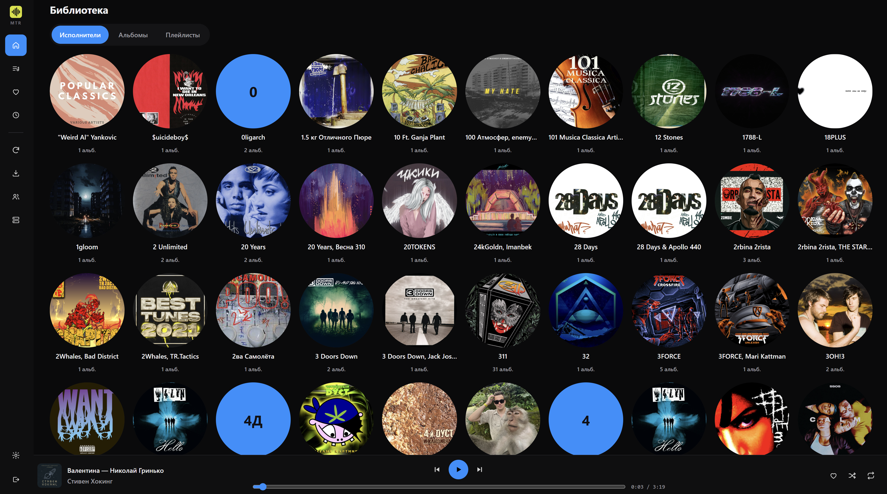
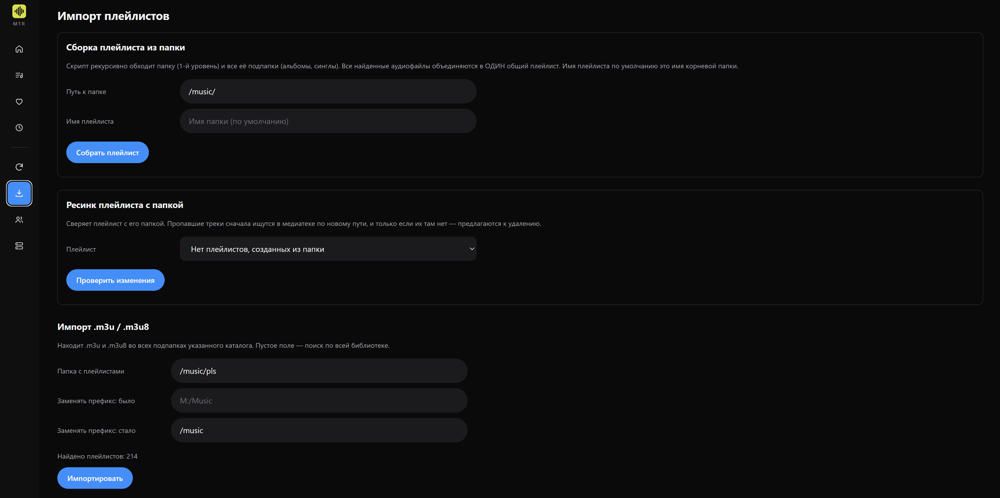
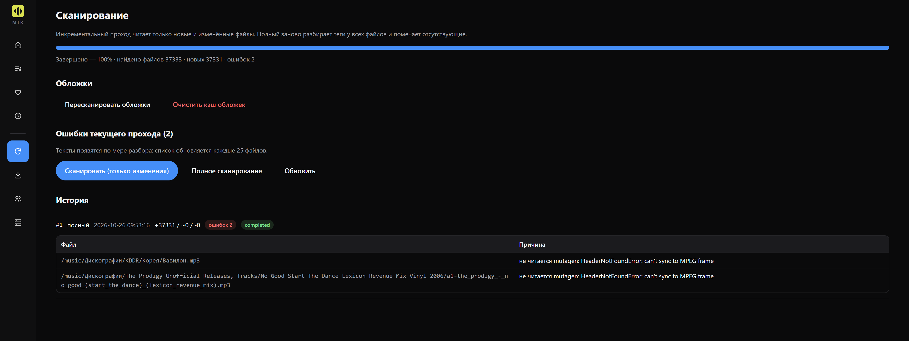

# MTR Music Server

Собственный музыкальный сервер, совместимый с Subsonic API. Python 3.13, FastAPI,
две изолированные базы SQLite, транскодирование через FFmpeg, Docker.

**Версия:** 0.23.2

Подробное описание возможностей — в [FEATURES.md](FEATURES.md).

---

## Что это

- Библиотека с обложками, поиском, плейлистами и избранным.
- Совместимость с Subsonic API: работают Symfonium, DSub, Ultrasonic, play:Sub и другие клиенты.
- Транскодирование на лету: mp3, flac, alac — под возможности сети и устройства.
- Импорт плейлистов из `.m3u`/`.m3u8`, в том числе из папок.
- Скан библиотеки и обложки живут в отдельном процессе: просмотр не ждёт индексацию.

`.env` не нужен. Всё, что задаётся один раз, лежит в `docker-compose.yml`,
всё остальное — в веб-интерфейсе и хранится в базе.

---

## Скриншоты







---

## Установка

Скрипт в корне проекта делает всё сам: проверяет требования, собирает образ,
запускает контейнер и проверяет собранное изнутри.

```bash
cd /путь/к/mtr

# 1. Укажите в docker-compose.yml свои пути — две строки в разделе volumes:
#      - /путь/к/музыке:/music:ro
#      - /путь/к/данным:/data

# 2. Запустите установщик
sh install-in-docker.sh
```

Откройте `http://адрес-сервера:4533`. При первом запуске откроется страница
создания администратора — пароль хранится только в базе, в виде хеша.

### Что делает `install-in-docker.sh`

1. **Проверяет требования**: Docker и Compose v2, память не меньше 512 МБ,
   свободное место не меньше 1 ГБ, архитектура amd64 или arm64.
   При несоответствии не падает, а спрашивает: «Продолжить установку несмотря на это? (y/N)».
2. **Спрашивает про кэш обложек.** «Удалить папку covers? (y/N)» — отдельный вопрос,
   отдельно от баз. Удаление безопасно: обложки создаются заново из тегов.
3. **Собирает образ** без кэша и удаляет образы прошлых версий.
4. **Запускает контейнер** и ждёт ответа `/healthz`.
5. **Проверяет изнутри**: Pillow и уменьшение обложек, декодер WebP, ffmpeg,
   команды CLI, монтирования, heartbeat worker-процесса.

Данные (`mtr_users.db`, `mtr_music.db`, `secret.key`) по умолчанию **не трогаются**.
Их удаление — только по явному подтверждению.

### Флаги

```bash
sh install-in-docker.sh                      # обычная установка, спросит всё сам
sh install-in-docker.sh --data-dir /путь/к/mtr-data   # если автопоиск не нашёл каталог
sh install-in-docker.sh --wipe-data --yes    # удалить базы и secret.key, собрать с нуля
sh install-in-docker.sh --wipe-covers        # удалить только кэш обложек
sh install-in-docker.sh --skip-checks        # пропустить проверку требований
sh install-in-docker.sh --help               # справка
```

Пустой ответ (Enter) на любой вопрос — безопасный вариант: ничего не удалять,
установку продолжать.

Самопроверку можно вызвать отдельно:

```bash
docker exec mtr-app sh /app/scripts/selfcheck.sh
```

---

## Пути в `docker-compose.yml`

Меняются две строки, остальное трогать не нужно. Внутри контейнера пути всегда
`/music` и `/data` — их менять нельзя.

```yaml
volumes:
  - /share/CACHEDEV1_DATA/Multimedia/Music:/music:ro   # библиотека, только чтение
  - /share/CACHEDEV1_DATA/Container/mtr-data:/data     # базы, ключ, кэш обложек
```

Другие варианты (есть в комментарии внутри `docker-compose.yml`):

- Windows + Docker Desktop: `D:/music_temp:/music:ro` и `D:/data:/data`
- Linux: `/mnt/music:/music:ro` и `/mnt/mtr-data:/data`
- Synology: `/volume1/music:/music:ro` и `/volume1/docker/mtr-data:/data`

Слева — путь на хосте, справа — внутри контейнера. `:ro` означает «только чтение»:
сервер в музыку не пишет никогда.

---

## Обновление

```bash
sh install-in-docker.sh
```

Скрипт остановит контейнер, соберёт новый образ и запустит. Базы и настройки
сохраняются. Если менялась схема базы, миграция применится при старте.

---

## Настройки

Всё меняется в интерфейсе и хранится в базе, переживает пересоздание контейнера.
Часть параметров применяется сразу, часть — после перезапуска (помечены в интерфейсе).

| Параметр | Что делает |
|---|---|
| Интервал скана | Страховочный инкрементальный скан, секунды. 0 — выключен |
| Заход скана | Сколько треков обрабатывать за один проход. 0 — все сразу |
| Лимит транскодов | Сколько ffmpeg-процессов одновременно |
| Формат по умолчанию | Формат отдачи, если клиент не указал свой |
| Пауза обложек: окно | Сколько секунд после действия пользователя фаза обложек ждёт |
| Пауза обложек: ожидание | Предельное ожидание одного альбома, чтобы фон не вставал совсем |
| Наблюдение за каталогом | Автоматический скан при изменениях файлов |

---

## Как это устроено

Два процесса в одном контейнере:

- **веб-сервер** — отдаёт интерфейс, API и стриминг;
- **worker** — скан библиотеки, наблюдение за папкой, фоновая фаза обложек.

Они не делят ни соединение с базой, ни event loop: пока идёт скан, интерфейс
отвечает нормально. Связь — через таблицу команд в базе и файл статуса,
поэтому она переживает перезапуск. Если worker падает, веб-сервер поднимает его сам.

### Диагностика

```bash
docker logs -f mtr-app                      # оба процесса, один поток
docker exec mtr-app sh /app/scripts/selfcheck.sh
```

В интерфейсе: раздел **Сканирование** — прогресс, история проходов, ошибки по файлам,
кнопки работы с обложками. Раздел **Сервер** — пути, версии схемы, состояние.

### Резервная копия

Достаточно каталога `/data`: там обе базы, ключ шифрования и кэш обложек.
Копировать на работающем контейнере не стоит — сначала `docker compose stop`,
потом копия, потом `docker compose start`. Кэш обложек (`covers/`) можно не копировать:
он восстановится.

---

## Лицензия

Проект распространяется по лицензии **GNU General Public License v3.0 (GPL-3.0)**.
Полный текст — в файле [LICENSE](LICENSE).

---

## История изменений

Подробности по этапам — в файлах `STAGE*.md`. Последние:

- **0.23.2** — баннер установщика, компактный список импорта, прогресс импорта m3u,
  крошка «Альбомы» открывает отдельный вид.
- **0.23.1** — поиск на главной больше не вешает сервер (агрегаты вместо подзапросов,
  отмена запросов при наборе).
- **0.23.0** — хлебные крошки, ссылка на исполнителя, обложки треков, настройка
  захода скана, `install-in-docker.sh`.
- **0.22.x** — скан и обложки в отдельном процессе (worker).
- **0.21.0** — чтение отдельно от записи в SQLite, пачки записи в сканере.
