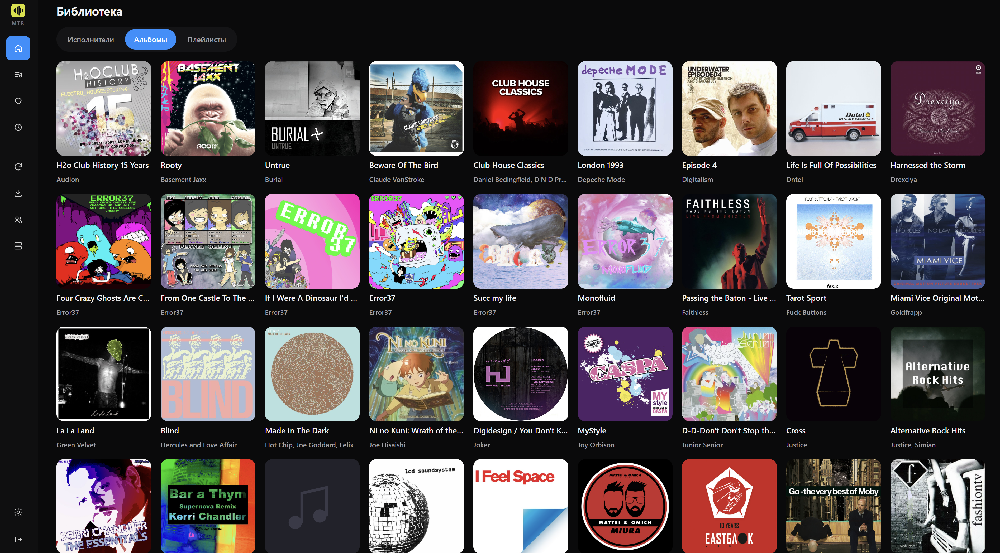
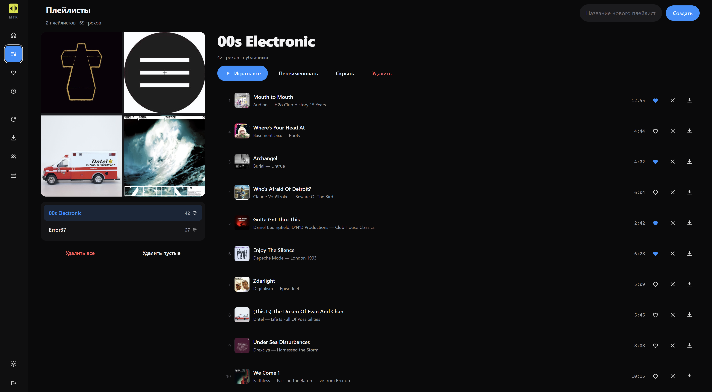

# MTR Music Server

Собственный музыкальный сервер, совместимый с Subsonic API. Python 3.13, FastAPI,
две изолированные базы SQLite, транскодирование через FFmpeg, Docker.

**Версия:** 0.23.1






## Лицензия

Этот проект распространяется под лицензией **GNU General Public License v3.0 (GPL-3.0)**. 
Полный текст лицензии см. в файле [LICENSE](LICENSE).

---

## Быстрый старт

`.env` не нужен. Всё, что задаётся один раз, лежит в `docker-compose.yml`,
всё остальное — в интерфейсе.

```bash
cd /share/CACHEDEV1_DATA/Container/mtr

# 1. Укажите в docker-compose.yml свои пути — две строки в разделе volumes:
#      - /путь/к/музыке:/music:ro
#      - /путь/к/данным:/data

# 2. Соберите и запустите
docker compose up -d --build

# 3. Первый скан
docker exec -it mtr-app python -m app.cli scan --mode full
```

Откройте `http://адрес-nas:4533`. При первом запуске откроется страница
создания администратора — пароль нигде в файлах не хранится, только в базе
в виде хеша.

Дальше вход — по имени и паролю (тем же, что для Subsonic).

### Что где задаётся

| Параметр | Где | Почему там |
|---|---|---|
| Путь к музыке | `docker-compose.yml` | Docker не может узнать путь на хосте из образа |
| Путь к состоянию | `docker-compose.yml` | то же самое |
| Порт | `docker-compose.yml` | проброс портов — дело Docker |
| Логин администратора | страница первого запуска | пароль не должен лежать в файлах |
| Ключ шифрования | создаётся сам в `/data/secret.key` | лежит вместе с данным, переживает пересоздание |
| Интервал скана | Настройки → Сервер | читается из базы при старте |
| Наблюдение за каталогом | Настройки → Сервер | то же |
| Лимит транскодирования | Настройки → Сервер | то же |
| Уровень логов | Настройки → Сервер | то же |
| Формат отдачи по умолчанию | Настройки → Сервер | то же |

Пути к музыке и к состоянию — единственное, что нельзя перенести в интерфейс:
контейнер получает их от Docker при создании. Всё остальное живёт в базе и
переживает `docker compose down` / `up`.

### Один важный момент про пути

В `docker-compose.yml` пути указаны **буквально**. Не через переменные:

```yaml
volumes:
  - /share/CACHEDEV1_DATA/Multimedia/Music:/music:ro
  - /share/CACHEDEV1_DATA/Container/mtr-data:/data
```

Это принципиально. Если написать `- ${MUSIC_PATH}:/music`, а переменная не
объявлена, Docker получит `- ":/music"` — валидную запись, означающую
«создай анонимный том». Ошибки не будет, просто внутри окажется пусто, а имя
тома будет выглядеть как хеш:

```
.../container-station-data/lib/docker/volumes/8e9ef7ff.../_data -> /music
```

Проверить, что смонтировалось правильно:

```bash
docker inspect mtr-app --format '{{range .Mounts}}{{.Source}} -> {{.Destination}} ({{.Mode}}){{"\n"}}{{end}}'
```

Должно быть так, и обязательно с `(ro)` у музыки:

```
/share/CACHEDEV1_DATA/Multimedia/Music -> /music (ro)
/share/CACHEDEV1_DATA/Container/mtr-data -> /data ()
```

Если источник похож на `.../volumes/<хеш>/_data` — смонтировался пустой том.
Сервер напишет об этом в лог сам: при непустой базе и пустом каталоге музыки
появится `ПРОБЛЕМА: база знает N треков, но каталог /music пуст`.

### Обновление

```bash
cd /share/CACHEDEV1_DATA/Container/mtr
cp -a /share/CACHEDEV1_DATA/Container/mtr-data \
      /share/CACHEDEV1_DATA/Container/mtr-data-backup-$(date +%F)
docker compose up -d --build
```

`.env` копировать больше не нужно — его нет.

### Наблюдение за библиотекой

Всё это — **Настройки → Сервер**. Значения хранятся в базе и переживают
пересоздание контейнера; `.env` и переменные окружения не нужны.

| Настройка | По умолчанию | Значения | Назначение |
|---|---|---|---|
| Наблюдение за библиотекой | выкл | вкл / выкл | следить за появлением и изменением файлов |
| Опрос вместо inotify | выкл | вкл / выкл | нужно на Windows и части сетевых томов |
| Период опроса, мс | 1000 | 100…60000 | частота чтения каталога при опросе |
| Интервал скана | 0 | 0…86400 | страховочный инкрементальный скан, секунд |

Часть из них (режим опроса и его период) применяется после перезапуска
контейнера — об этом честно написано на странице настроек. Интервал скана
и включение наблюдения применяются сразу.

#### Почему на Windows обязателен `MTR_WATCH_POLL=1`

Docker Desktop монтирует папки Windows через 9p/virtiofs. Inotify-события
через эту границу **не передаются**: контейнер физически не получает
уведомлений об изменении файлов на `D:/…`. Наблюдение в режиме inotify
там просто не сработает — файл появится на диске, а сервер его не увидит
никогда. Опрос (`MTR_WATCH_POLL=1`) читает каталог по таймеру и работает.

На Linux и macOS с нативными томами inotify работает и дешевле опроса.

#### Измеренная стоимость CPU (5–6 секунд наблюдения на каждом объеме)

| Режим | CPU | Задержка появления трека |
|---|---|---|
| inotify | 0.0% ядра | ~0.1 с |
| опрос 1000 мс | 0.2% ядра | 1.2–3.1 с |
| опрос 2000 мс | — | 3.1 с |

| Файлов | inotify | опрос 1000 мс | опрос 5000 мс |
|---|---|---|---|
| 200 | 0.0% | 0.2% | 0.2% |
| 2 000 | 0.0% | 0.8% | 0.0% |
| 6 000 | 0.2% | 1.8% | 0.4% |

Нагрузка опроса растет примерно линейно с числом файлов, поэтому на больших
библиотеках период важнее всего: при 6 000 файлов переход с 1 с на 5 с
снижает CPU почти в 5 раз. Измерений на 10 000+ файлов в этой версии нет —
проверьте на своей библиотеке через `top` в контейнере.

#### Готовые наборы

Значения ниже ставятся в **Настройки → Сервер**, а не в файлы.

**Windows, Docker Desktop** — inotify через 9p/virtiofs не работает,
опрос обязателен:

| Настройка | Значение |
|---|---|
| Наблюдение за библиотекой | вкл |
| Опрос вместо inotify | вкл |
| Период опроса, мс | 1000 |
| Интервал скана | 300 |

**Маленькая библиотека (до ~5 000 файлов)**, хочется быстрее: период опроса
500, интервал скана 600.

**Большая библиотека (50 000+) на Windows** — опрос дорог, поэтому реже:
период 10000, интервал 3600.

**Linux / macOS, нативный том** (inotify, опрос не нужен): наблюдение вкл,
опрос выкл, интервал скана 0.

**Linux, но музыка на сетевой шаре** (NFS/SMB/CIFS) — inotify по сети не
работает, как и на Windows: наблюдение вкл, опрос вкл, период 2000,
интервал 1800.

**Только по расписанию** (наблюдение выключено, минимум нагрузки на ФС;
изменения видны с задержкой до интервала): наблюдение выкл, интервал 600.

**Полностью вручную** (только `docker exec … cli scan`): наблюдение выкл,
интервал 0.

#### Что делает `MTR_SCAN_INTERVAL` и зачем он нужен при работающем наблюдении

Это страховка, а не дубль. Наблюдение может пропустить событие:

- debounce склеивает пачку событий, и часть файлов в окно не попадает
  (проверено: из двух файлов альбома пришло одно событие);
- файл скопирован до старта контейнера, событий не было вовсе;
- опрос пропустил изменение между тиками при быстрой перезаписи.

Периодический полный инкрементальный скан закрывает эти дыры. Он читает
только метаданные файлов (`size`, `mtime`) и разбирает теги лишь у
измененных — на 10 000 треков это секунды, не минуты.

Разумные значения: `300` для активной работы с библиотекой, `1800–3600`
для стабильной коллекции, `0` — если вы добавляете музыку только вручную.

#### Задержка появления трека

Итоговая задержка = `debounce (2 с)` + «Период опроса» + `FLUSH_DELAY (2 с)`.
При настройках по умолчанию это 3–5 секунд. Уменьшать период опроса
ниже 500 мс смысла нет: `watchfiles` все равно обходит дерево, а нагрузка
растет линейно.

---

## Процедуры безопасности

### 1. Ключ шифрования

Задавать его вручную не нужно. При первом старте ключ создаётся
автоматически в `/data/secret.key` (права 0600, атомарная запись) и дальше
просто читается оттуда. Он лежит в томе с данными и переживает
`docker compose down` / `up`, пересборку образа и перезапуск NAS.

Что важно знать:

- **не удаляйте `/data/secret.key`** — без него сохранённые пароли не
  расшифровать, и Subsonic-авторизация начнёт возвращать код 40;
- ключ уже содержит достаточно энтропии, генерировать ничего не нужно;
- переменная `MTR_SECRET_KEY` по-прежнему поддерживается, но она **перебивает
  файл**: если задать её один раз и потом убрать, сервер вернётся к файлу, а
  это уже другой ключ. Не используйте её без необходимости.

Проверить, откуда взят ключ:

```bash
docker logs mtr-app 2>&1 | grep -i "ключ шифрования"
```

`прочитан из /data/secret.key` — всё хорошо.
`сгенерирован новый ключ` — том с данными смонтирован не туда или был пуст.

### 2. Проверка состояния сервера

```bash
docker exec -it mtr-app python -m app.cli doctor
```

Проверяет: каталог музыки, длину ключа, читаемость паролей всех пользователей,
наличие активного админа, количество треков. **Код возврата 1**, если есть проблемы.
Тот же отчет частично пишется в лог при старте.

### 3. Потеря или смена ключа (восстановление после смены)

**Симптом:** `ping` с верным токеном отдаёт код 40
(`Wrong username or password`), `doctor` сообщает «пароли пользователей не
расшифровываются текущим ключом».

**Причина:** `md5(password + salt)` требует расшифровки пароля, а новый ключ
её не даёт. PBKDF2-хеш при этом остаётся валидным — поэтому вход по паролю
в веб-интерфейсе продолжает работать.

Ключ меняется в двух случаях: файл `/data/secret.key` потеряли (пересоздали
том, восстановили не тот бэкап) или задали `MTR_SECRET_KEY`, перебивающую файл.

**Восстановление без потери данных:**

```bash
# 1. диагноз
docker exec -it mtr-app python -m app.cli doctor

# 2. вход по паролю — обратимая копия перешифруется автоматически
curl "http://localhost:4533/rest/ping.view?u=admin&p=ВАШ_ПАРОЛЬ&v=1.16.1&c=fix&f=json"

# 3. проверка
docker exec -it mtr-app python -m app.cli doctor   # должно быть чисто
```

Если пароль неизвестен:

```bash
docker exec -it mtr-app python -m app.cli setpassword --username admin
```

> Шаг 2 требует временно включить открытый пароль (см. процедуру 7).

**Если ключ потерян окончательно** и войти некому — задайте пароли заново:

```bash
docker exec -it mtr-app python -m app.cli setpassword --username admin
```

Пользователи, музыка и плейлисты при этом не пострадают: теряются только
обратимые копии паролей, которые перезаписываются при следующем входе.

### 4. Резервное копирование

Копировать нужно **один** артефакт: каталог `/data` (обе базы + ключ).
`.env` больше нет, пути заданы в `docker-compose.yml`.

```bash
docker run --rm -v mtr-data:/data -v "$PWD":/backup alpine \
  tar -czf /backup/mtr-backup-$(date +%F).tar.gz -C /data .
```

Что внутри `/data`:

| Файл | Содержимое | Критичность                    |
|---|---|--------------------------------|
| `mtr_users.db` | пользователи, роли, сессии | высокая                        |
| `mtr_music.db` | метаданные, плейлисты, статистика | средняя (пересоздается сканом) |
| `secret.key` | ключ, если не задан в env | **критическая**                |

`mtr_music.db` восстановима полным сканом. `mtr_users.db` — нет: без нее
пользователи и плейлисты теряются. Без ключа пароли нечитаемы.

### 5. Разграничение доступа

| Роль | Права                                                 |
|---|-------------------------------------------------------|
| `admin` | все: пользователи, `startScan`, `getUsers`, настройки |
| `user` | прослушивание, плейлисты, избранное                   |

```bash
# создать пользователя
docker exec -it mtr-app python -m app.cli createuser --username alice --role user
# заблокировать (не удаляя)
# через API администратором, либо:
docker exec -it mtr-app python -m app.cli doctor   # покажет заблокированных
```

Защита от блокировки: **последнего активного администратора** нельзя
заблокировать, удалить или понизить — иначе управление потеряется.

### 6. Сетевая экспозиция

По умолчанию сервер слушает `0.0.0.0:4533` **без TLS**. Это допустимо только
в доверенной локальной сети.

**Для доступа извне — обратный прокси с HTTPS:**

```nginx
server {
    listen 443 ssl http2;
    server_name music.example.com;

    ssl_certificate     /etc/letsencrypt/live/music.example.com/fullchain.pem;
    ssl_certificate_key /etc/letsencrypt/live/music.example.com/privkey.pem;
    ssl_protocols       TLSv1.2 TLSv1.3;

    client_max_body_size 50m;
    proxy_read_timeout   3600s;   # долгие стримы не должны обрываться

    location / {
        proxy_pass http://127.0.0.1:4533;
        proxy_set_header Host              $host;
        proxy_set_header X-Real-IP         $remote_addr;
        proxy_set_header X-Forwarded-Proto $scheme;
        proxy_buffering off;      # иначе аудио копится целиком
        proxy_request_buffering off;
    }
}
```

**Важно:** троттлинг неудачных входов считает IP из `request.client`, а не из
`X-Forwarded-For` (заголовок подделывается). За прокси IP будет адресом прокси,
то есть лимит действует на всех клиентов суммарно. Если это мешает — отдавайте
прокси реальный IP через `proxy_protocol` или настройте доверенные прокси явно.

### 7. Открытый пароль в URL — только для восстановления

Subsonic поддерживает три способа передачи пароля:

| Способ | Параметры | Безопасность                  |
|---|---|-------------------------------|
| **Токен** (рекомендуется) | `t=md5(пароль+соль)&s=соль` | пароль не передается          |
| Hex | `p=enc:<hex>` | пароль восстановим из запроса |
| Открытый | `p=<пароль>` | **попадает в логи и историю** |

Открытый пароль в URL оказывается в: истории браузера, access-логах прокси,
заголовке `Referer` при переходах. Используйте его **только** для аварийного
входа по процедуре 3, не сохраняйте такие ссылки.

Значения `p`, `t`, `s`, `jwt` **маскируются** в логах приложения (`p=***`),
но это не защищает от логов прокси и истории браузера.

### 8. Обновление

```bash
docker compose down
docker compose up -d --build
docker exec -it mtr-app python -m app.cli doctor
```

Миграции схемы применяются автоматически по `PRAGMA user_version`.
Откат на старую версию при более новой схеме сервер **откажется** выполнять
(защита от порчи данных) — восстанавливайте `/data` из бэкапа.

---

## Аудит безопасности: результаты

Проверено на версии 0.3.3.

### Закрытые проблемы

**1. Пароль в access-логах (исправлено).**
uvicorn по умолчанию пишет строку запроса целиком:
`GET /rest/ping.view?u=admin&p=changeme123 HTTP/1.1 200`. Пароль оказывался
в `docker logs`. Добавлен `RedactSecretsFilter`: значения `p`, `t`, `s`, `jwt`,
`password`, `token`, `salt`, `key` заменяются на `***` до записи.

**2. Служебные эндпоинты были анонимны (исправлено).**
`/api/v1/stats`, `/api/v1/info` и главная страница отдавали количество треков,
число пользователей и **абсолютный путь к музыке** без авторизации.
Теперь требуют Subsonic-учетные данные и возвращают HTTP 401. `/healthz`
остается открытым — его вызывает `HEALTHCHECK` из Dockerfile.

**3. Не было security-заголовков (исправлено).**
Добавлены `X-Content-Type-Options: nosniff`, `X-Frame-Options: DENY`,
`Referrer-Policy: no-referrer`, а для HTML — `Content-Security-Policy`.
Middleware написан на чистом ASGI, а не `BaseHTTPMiddleware`: последний
буферизует поток и ломает стриминг (проверено тестом).

### Проверено и признано корректным

| Проверка | Результат                                                                                                                                                                                                                                |
|---|------------------------------------------------------------------------------------------------------------------------------------------------------------------------------------------------------------------------------------------|
| **SQL-инъекции** | Все параметры через плейсхолдеры. Единственный динамический фрагмент — `ORDER BY` в списках альбомов; берется из `ALBUM_SORTS`, ключи не совпадают со значением клиента → fallback на дефолт. `PRAGMA user_version` кастуется в `int()`. |
| **Path traversal** | Невозможен: путь к файлу берется только из `tracks.path`, заполняемого сканером. `id` в запросах приводится к `int`.                                                                                                                     |
| **Перебор паролей** | Троттлинг: 10 неудач за 5 минут по ключу `username\|ip` → блокировка.                                                                                                                                                                    |
| **Перечисление логинов** | Неизвестный пользователь и неверный пароль дают идентичный ответ (код 40).                                                                                                                                                               |
| **Сравнение секретов** | `hmac.compare_digest` для токенов и паролей (постоянное время).                                                                                                                                                                          |
| **Хранение паролей** | PBKDF2-HMAC-SHA256, 600 000 итераций + Fernet (AES+HMAC) для обратимой копии, нужной Subsonic-токену.                                                                                                                                    |
| **Утечка секретов в ответах** | `UserRecord.to_public()` не содержит `password_enc`/`password_hash`; в `getUsers` пароли не отдаются.                                                                                                                                    |
| **Обход через регистр логина** | `COLLATE NOCASE` + уникальный индекс: `Alice` и `alice` — один аккаунт.                                                                                                                                                                  |
| **JWT-подмена** | Честный отказ кодом 41, а не молчаливый пропуск.                                                                                                                                                                                         |

### Известные ограничения

- **Нет TLS из коробки** — только через обратный прокси (процедура 6).
- **Троттлинг в памяти процесса.** При нескольких воркерах uvicorn лимит кратно
  выше. Для одного контейнера (текущая конфигурация) работает как задумано.
- **Пароли защищены обратимым шифрованием**, а не хэшем, — вынужденная плата
  за Subsonic token-авторизацию. Компрометация `MTR_SECRET_KEY` + `/data`
  раскрывает пароли. Отсюда требования к длине ключа и бэкапам.
- **Нет 2FA, нет ограничения по IP, нет аудита действий пользователей.**
- **`/docs` и `/openapi.json`** открыты: раскрывают структуру API, но не данные.
  Для публичного инстанса закройте их в `main.py` (`docs_url=None`).
- **Нет ограничения размера запроса** — актуально для загрузки m3u8 на этапе 7.

---

## Иконки интерфейса

Все иконки — отдельные SVG-файлы в `app/web/static/icons/`, размер в файле
24×24, на экране 18×18 (задается CSS). Цвет берется из `currentColor`
внутри SVG и инвертируется под темную тему фильтром, поэтому отдельных
цветных копий нет.

**Эмодзи и символьные глифы в коде не используются.** Причина: `▶`, `★`,
`⚙` выглядят по-разному в Windows, Linux и macOS, а некоторые шрифты
подменяют их цветными эмодзи. Иконки-файлы дают одинаковый вид везде.

Список: `play`, `pause`, `next`, `prev`, `shuffle`, `repeat`, `repeat-one`,
`star`, `star-outline`, `plus`, `remove`, `gear`, `download`, `arrow-left`,
`search`, `refresh`, `chevron-down`, `check`.

Статика отдается маршрутом `/static/icons/{name}` с проверкой имени
по шаблону: только строчные буквы, цифры и дефис, только `.svg`.
Обход каталогов невозможен.

## Сканирование библиотеки

Раздел «Сканирование» в меню настроек (только администратор).

### Что показывает

- **Прогресс-бар** с этапом: «Обход каталога…» → «Разбор тегов…».
- Процент разбора, сколько файлов уже обработано из найденных, счетчики
  добавленных, обновленных и удаленных.
- **История** последних 10 запусков: режим, время, итоги, статус.
- Состояние наблюдателя за каталогом (если включен).

### Режимы

| Кнопка | Что делает                                                            |
|---|-----------------------------------------------------------------------|
| Сканировать (только изменения) | читает метаданные и разбирает теги только у новых и измененных файлов |
| Полное сканирование | заново разбирает теги у всех файлов и помечает отсутствующие          |

Инкрементальный проход дешевле: он сравнивает `size` и `mtime`, а теги
читает лишь у изменившегося. Полный нужен после массовой правки тегов
или переезда файлов.

### Прогресс в реальном времени

Два механизма, потому что одного мало:

- `GET /api/web/scan/status` — опрос раз в секунду, пока идет скан.
  Работает всегда, в том числе после перезагрузки страницы.
- `WebSocket /ws/scan` — push-уведомления об изменениях.

Опрос обязателен: WebSocket рвется при перезагрузке вкладки, и без опроса
индикатор оставался бы «замороженным» на середине.

### Защита от двойного запуска

Состояние сканера — один объект на процесс с локом. Вторая вкладка
получит `409 Сканирование уже выполняется` вместо второго параллельного
прохода. Причина: два скана одновременно читают одни и те же файлы и
пишут в одну таблицу — это лишняя нагрузка и гонки.

## Диалоги интерфейса

Подтверждения и ввод строки сделаны **собственными модальными окнами**
(`app/web/static/dialogs.js`), а не `confirm()` и `prompt()`.

### Почему не нативные

Chrome после нескольких нативных диалогов подряд показывает галочку
«Предотвратить создание дополнительных диалоговых окон». Если ее поставить
(или браузер решит сам), **все последующие `confirm()` молча возвращают
`false`**. Внешне это выглядит так: удалили три плейлиста — и кнопка
«Удалить» перестала работать, без единого сообщения об ошибке.

Собственные диалоги этой проблемы не имеют: они часть страницы, а не
окно браузера. Дополнительно они одинаково выглядят во всех браузерах,
работают в мобильном виде и закрываются по `Esc` и клику мимо окна.

### Где используется

Удаление плейлиста, удаление пользователя, смена пароля, переименование
плейлиста, очистка кэша обложек, массовое удаление плейлистов.

## Массовое удаление плейлистов

В разделе «Плейлисты» две кнопки:

| Кнопка | Что удаляет                                                |
|---|------------------------------------------------------------|
| Удалить все | все ваши плейлисты; сами треки в библиотеке остаются       |
| Удалить пустые | только плейлисты с нулем треков — следы неудачного импорта |

Обе показывают подтверждение с точным количеством. Обычный пользователь
удаляет только свои плейлисты; чужие не затрагиваются даже при
`scope="all"` — это разрешено только администратору.

Эндпоинт: `POST /api/web/playlists/purge` с телом `{"scope": "mine|empty|all"}`.
Возвращает, сколько удалено, сколько пропущено и список ошибок.

## Импорт плейлистов из папки

Раздел «Импорт плейлистов» в меню настроек (только администратор).
Нужен, когда .m3u/.m3u8 уже есть на диске: из старых плееров, с другой
машины или размазаны по библиотеке.

### Как работает

1. Указываете **папку** — она обходится рекурсивно, со всеми подпапками.
   Поле пустое — поиск идет по всей библиотеке (`/music`).
2. Нажимаете **Импортировать** — сервер находит все `.m3u` и `.m3u8`
   и разбирает каждый. Ничего не записывается: сначала показывается разбор.
3. Видите таблицу: имя плейлиста, сколько треков сопоставлено из скольких,
   и что именно не нашлось.
4. Выбираете действие и нажимаете **Применить**.

### Сопоставление путей

Три попытки по порядку, от точной к мягкой:

| Способ | Когда срабатывает |
|---|---|
| точный путь | путь из m3u8 совпадает с `tracks.path` |
| по имени файла | путь не совпал, но файл с таким именем в библиотеке один |
| по артисту и названию | из тега `#EXTINF`, если путь восстановить нельзя |

**Замена префикса.** Если плейлист создан на другой машине, пути там
другие: `M:\Music\All\...` вместо `/music/All/...`. В полях «было» и
«стало» задается пара для подстановки. Сравнение без учета регистра —
Windows-пути регистр не различают.

Нормализация путей при этом обязательна и делается всегда: обратные слэши
превращаются в прямые, повторные слэши схлопываются, `..` разрешается.
Без этого `/music//a///b.mp3` и `/music/a/b.mp3` считались бы разными
файлами.

### Что делать с несопоставленными

Для каждой ненайденной записи показывается блок «Не найдено: N — выбрать
вручную». Внутри — список кандидатов из библиотеки (совпадения по имени
файла и по названию). Выбираете нужный трек — он попадет в плейлист при
применении. Если не выбирать, запись просто пропускается.

Кандидаты показываются, а не подставляются автоматически, намеренно:
угадывание при неоднозначности чаще портит плейлист, чем помогает.

### Повторный импорт

Имя плейлиста — имя файла без расширения. Если плейлист с таким именем
уже есть у вас, предлагается выбор:

| Действие | Результат                                           |
|---|-----------------------------------------------------|
| Дополнить существующий | добавляет только недостающие треки, старые остаются |
| Заменить (удалить старый) | удаляет старый плейлист и создает новый из файла    |
| Создать новый | оставляет оба плейлиста с одинаковым именем         |
| Пропустить | ничего не делает                                    |

### Владелец и приватность

Импортированные плейлисты принадлежат тому, кто импортировал, и
**по умолчанию приватные**. Галочка «публичный» у каждого плейлиста
делает его видимым другим пользователям.

### Индикация

У каждого плейлиста в таблице есть индикатор: во время применения —
вращающийся лоадер, после — галочка при успехе или крестик при ошибке.
Текст рядом показывает результат: «создано, треков 5», «добавлено 3»
или причину ошибки.

### Пустые имена

Пустое имя плейлиста недопустимо: Subsonic-клиенты показывают такой
плейлист как «без имени». Если файл называется только расширением
(`.m3u8`), имя берется из названия папки. Проверено, что в ответе
`getPlaylists` имя непустое.

### Почему не появляются дубли

Две защиты.

**1. Одинаковые имена файлов.** Многие программы сохраняют плейлист сразу
в двух форматах: `311.m3u` и `311.m3u8`. Имя плейлиста берется из имени
файла без расширения, поэтому оба файла давали плейлист «311» — и он
импортировался дважды. Теперь файлы с одинаковым именем в одном каталоге
схлопываются в один, приоритет у `.m3u8` (он гарантированно UTF-8).
В отчете это видно как предупреждение «дубликат имени».

**2. Устаревший список существующих.** Список плейлистов для проверки
совпадения имен читался один раз **до** цикла импорта. Плейлист,
созданный в этом же запросе, в нем отсутствовал, поэтому следующий файл
с тем же именем создавал второй такой же. Теперь список обновляется после
каждого создания и замены.

Дополнительно: файл, который не разобрался (пустой, битая кодировка,
HLS), **не создает плейлист с нулем треков**. Он попадает в отчет как
ошибка. Раньше пустой «фантом» появлялся рядом с рабочим плейлистом и
выглядел как дубль.

### Ограничения

- Обход ограничен 2000 файлами и глубиной 12 уровней: случайно указанный
  корень диска не должен вешать сервер.
- Служебные каталоги (`.git`, `@eaDir`, `$RECYCLE.BIN`) не обходятся.
- Кодировка определяется перебором: UTF-8, затем cp1251 (старые
  Windows-плейлисты с русскими именами), затем latin-1.
- HLS-плейлисты (`#EXT-X-...`, сегменты `.ts`) отклоняются: это видеопоток,
  а не список треков.

## Оформление интерфейса

Стиль: почти черный холст, панели без рамок, скругленные «пилюли»,
крупные обложки, узкий левый рейл с иконками. Все в одном CSS
(`static/style.css`), цвета — в `static/theme.css`.

### Акцент на активных иконках

Все иконки — черные SVG в ``. Внутри картинки `currentColor` не
работает: это не элемент документа, а ее собственные пиксели.

**Активный пункт рейла:** заливка `background: var(--accent)`, иконка
остается черной (`filter: none`) — максимальный контраст, как у `.primary`.

**Сердце «в избранном», перемешать и повтор:** акцентные, но ``
тут не подходит. Даже с `mask` на картинке ее черные пиксели рисуются
**поверх** `background-color` и перекрывают акцент — проверено по
пикселям: ноль акцентных.

Поэтому сам `` скрывается (`opacity: 0`), а форму рисует
псевдоэлемент кнопки с `mask: var(--icon-url)` и
`background-color: var(--accent)`. Переменную `--icon-url` выставляет
`icon()` и `hydrateIconVars()` — на **кнопке**, а не только на картинке,
потому что маска живет на `::after` кнопки.

Цвет берется из `theme.css` и меняется вместе с акцентом.

### Раскладка: страница на месте, скролл внутри

`.pl-layout` имеет фиксированную высоту
`calc(100vh - var(--player-h) - 260px)`, а прокрутка включена только
у правой колонки (`overflow-y: auto`). Страница не уезжает, список
треков прокручивается внутри своей колонки. На экранах уже 1100px
высота становится автоматической — иначе на телефоне колонка была бы
высотой в пару строк.

Коллаж в плейлистах ограничен `max-width: 300px`: в колонке 45% он
раздувался и выталкивал раскладку за экран.

### Сердце в плеере

В блоке `.player-right` первой кнопкой стоит сердце — «в избранное» для
текущего трека. Оно синхронизировано со строкой трека: клик в плеере
обновляет и список, клик в списке обновляет плеер.

Пока ничего не играет, сердце скрыто: пустая иконка без трека путает.

### Сворачиваемые секции

«Недавно добавленные» и «Недавно прослушанные» на главной — аккордеоны,
**свернуты по умолчанию**. Состояние хранится в `localStorage`
(`mtr.collapsedSections`), поэтому после перезагрузки остается как было.
Если хранилище недоступно (приватный режим), секции просто остаются
свернутыми.

Заголовок — кнопка со стрелкой: вправо в свернутом виде, вниз
в развернутом. `aria-expanded` и `aria-controls` выставлены, чтобы
состояние читали скринридеры.

### Раскладка страниц

**Главная («Библиотека»).** Ширина контента — 96% площади справа от рейла
(`calc((100vw - var(--rail-w)) * 0.96)`). Сверху «Недавно добавленные»
и «Недавно прослушанные», ниже переключатель видов. Исполнители на главную
не выводятся: они только в своем виде, сеткой, как альбомы, но круглыми
аватарами.

**Альбом.** Две равные колонки: слева обложка, справа название, исполнитель,
метаданные и кнопки. Треки — ниже, во всю ширину.

**Избранное.** Та же раскладка, что у альбома. Вместо обложки — коллаж 2×2
из четырех случайных обложек треков избранного. Подбор кэшируется по составу:
при перерисовке картинки не меняются, но обновляются, если состав изменился.

**Плейлисты.** Две колонки: слева 25% — коллаж выбранного плейлиста,
затем список плейлистов и массовые действия под ним; справа — название,
счетчик треков, кнопки управления и список треков. Внутренней прокрутки
нет, страница прокручивается целиком. Под 900px одна колонка: сначала
содержимое плейлиста, ниже навигация по списку.

**Кнопки.** Все кнопки — `inline-flex` с `white-space: nowrap`, поэтому
иконка и текст не разъезжаются на две строки.

### Акцентное сердце

SVG внутри `` не наследует `currentColor` — для картинки это всегда
ее собственный цвет. Поэтому «сердце в избранном» красится не фильтром,
а через CSS-маску: SVG служит трафаретом, а цвет задает
`background-color: var(--accent)`. При смене акцента в `theme.css` сердце
меняется вместе с ним.

### Акцентный цвет в одном месте

`app/web/static/theme.css` — единственный файл, где задан акцент.
Чтобы сменить его во всем интерфейсе, достаточно поправить четыре
переменные:

```css
:root {
  --accent: #d7e021;                      /* основной (сейчас — из фавикона) */
  --accent-ink: #101014;                  /* текст НА акцентном фоне */
  --accent-soft: rgba(215, 224, 33, .14); /* фоны и подсветки */
  --accent-dark: #bcc41c;                 /* наведение */
}
```
`style.css` ссылается только на `var(--accent…)`, своих цветов не содержит.

### Левая навигация (рейл)

Все разделы переехали в рейл. В шапке осталось только имя пользователя.

| Иконка | Раздел |
|---|---|
| дом | Библиотека |
| лупа | фокус в поиск на текущей странице |
| список с нотой | Плейлисты |
| сердце | Избранное |
| часы | Недавно прослушанные |
| обновление, импорт, люди, сервер | админ-разделы |
| шестеренка (внизу) | Настройки, Аккаунт, Выход |

Активный раздел залит акцентным цветом. У иконок есть подпись-тултип
справа при наведении.

### Главная страница («Библиотека»)

Сверху вниз:

1. **Поиск** и кнопка пересканирования.
2. **Исполнители** — горизонтальный ряд круглых аватаров. Обложек у
   исполнителей нет, поэтому берется обложка его первого альбома;
   если ее нет — инициалы на акцентном фоне.
3. **Недавно добавленные** — крупные карточки альбомов.
4. **Недавно прослушанные** — строки с номером, миниатюрой, названием
   и длительностью. Секция скрыта, пока истории нет.
5. Переключатель вида (исполнители / альбомы / плейлисты) и сам список.

### Плеер

Три зоны: трек с обложкой слева, транспорт и прогресс по центру,
перемешивание и повтор справа. Кнопка «играть» — круглая, акцентная.
На телефоне плеер перестраивается в два ряда, а контент получает
дополнительный нижний отступ, чтобы последние строки не уходили под него.

### История прослушиваний

Таблица `playback_log` уже существовала: в нее пишет Subsonic `scrobble`.
Добавлена запись из веб-плеера — `POST /api/web/play-event` при старте
трека. Теперь история копится и от Subsonic-клиентов, и от браузера.

`GET /api/web/recently-played` возвращает последние треки **пользователя**
без повторов: один трек — одна строка, на позиции последнего
прослушивания. Сортировка идет по `id` записи журнала, а не по
`played_at`: время хранится с точностью до секунды, и два прослушивания
подряд получают одинаковую метку.

### Сердце вместо звезды

Кнопка избранного использует `heart.svg` / `heart-filled.svg`. Название
раздела и API остались прежними («Избранное», `/star`), изменилась только
иконка.

## Веб-интерфейс

`http://localhost:4533` — полное управление сервером из браузера.

### Что доступно

| Раздел | Обычный пользователь | Администратор |
|---|---|---|
| Библиотека, поиск, прослушивание | да | да |
| Свои плейлисты | да | да |
| Свой пароль, свои сессии | да | да |
| Пользователи (создание, роли, блокировка, пароли) | — | да |
| Сервер: состояние, пересканирование, кэш обложек | — | да |

### Аутентификация

Отдельно от Subsonic: **серверные сессии**, а не токен в URL.

- В cookie `mtr_session` лежит случайный токен, в БД — только его SHA-256.
  Утечка базы не дает войти по чужой сессии.
- Cookie `HttpOnly` + `SameSite=Lax`. За HTTPS-прокси включите
  `MTR_COOKIE_SECURE=1`, тогда добавится флаг `Secure`.
- **CSRF**: изменяющие методы требуют заголовок `X-CSRF-Token`; значение
  приходит в cookie `mtr_csrf` и в `data-csrf` на странице. Без него — 403.
- Срок сессии 30 дней, не более 10 сессий на пользователя (старые вытесняются).
- Смена пароля администратором или блокировка **немедленно** отзывают все
  сессии пользователя.

### Плеер

Ходит на `/stream?id=…` с cookie сессии. Бинарные методы (`stream`,
`download`, `getCoverArt`) принимают **либо** Subsonic-параметры `u/t/s`,
**либо** сессию — так работают и браузер, и сторонние Subsonic-клиенты.

### Ограничения интерфейса

- Нет загрузки файлов и редактирования тегов — библиотека только читается.
- Плеер без очереди воспроизведения и без перемотки по треку из списка.
- Интерфейс без сборки: один JS-файл, никаких CDN (строгий CSP).
- Пересканирование синхронное: на большой библиотеке вкладка ждет ответа.
  Прогресс в реальном времени — через `/ws/scan`, в UI он пока не выведен.

## Subsonic API

**Библиотека:** `ping`, `getLicense`, `getMusicFolders`, `getScanStatus`,
`startScan` (admin), `getUser`, `getUsers` (admin), `getArtists`, `getIndexes`,
`getArtist`, `getAlbum`, `getAlbumList`, `getAlbumList2`, `getSong`, `getGenres`,
`search`, `search2`, `search3`, `stream`, `download`.

**Плейлисты и личное:** `getPlaylists`, `getPlaylist`, `createPlaylist`,
`updatePlaylist`, `deletePlaylist`, `star`, `unstar`, `getStarred`/`getStarred2`,
`setRating`, `scrobble`, `exportPlaylist` (M3U8).

Каждый метод доступен как `/rest/<method>.view` и `/rest/<method>`.

### Авторизация

```bash
# PowerShell
$salt = "abc123def456"
$md5  = [System.Security.Cryptography.MD5]::Create()
$token = -join ($md5.ComputeHash([Text.Encoding]::UTF8.GetBytes("пароль" + $salt)) | % { $_.ToString("x2") })
$q = "u=admin&t=$token&s=$salt&v=1.16.1&c=browser&f=json"
```

```bash
# bash
SALT=abc123def456
TOKEN=$(printf '%s' "пароль$SALT" | md5sum | cut -d' ' -f1)
Q="u=admin&t=$TOKEN&s=$SALT&v=1.16.1&c=browser&f=json"
```

### Коды ошибок

| Ситуация | Код | HTTP |
|---|---|---|
| Нет параметра | 10 | 200 |
| Неверные учетные данные | 40 | 200 |
| JWT вместо токена | 41 | 200 |
| Нет прав (не admin) | 50 | 200 |
| Не найдено | 70 | 200 |
| `stream`/`download` без авторизации | — | **401** |
| `/api/v1/*` без авторизации | — | **401** |

Разница намеренная: JSON-методы следуют протоколу (HTTP 200 + код в теле),
бинарные — HTTP-семантике, иначе плеер не понимает, что нужен пароль.

### Форматы транскодирования

`raw` (как есть) · `mp3_128` · `mp3_256` · `mp3_320` · `mp3_v0` · `flac` · `alac`

`timeOffset` при `raw` копирует поток без перекодирования. `maxBitRate`
учитывается: FLAC + `maxBitRate=128` → `mp3_128`.

Заголовки ответа: `X-MTR-Format` (фактический формат), `X-MTR-Strategy`
(`file`/`copy`/`encode`), `X-MTR-Substituted` (формат подменен — не апскейлим).

---

## CLI

```bash
python -m app.cli initdb          # создать/мигрировать базы
python -m app.cli createuser      # создать пользователя
python -m app.cli setpassword     # задать пароль заново (сброс)
python -m app.cli doctor          # диагностика, код 1 при проблемах
python -m app.cli scan            # индексация (--mode full|incremental)
python -m app.cli stats           # сводка
python -m app.cli purge-missing   # удалить треки с исчезнувшими файлами
```

---

## Архитектура

Две **изолированные** базы SQLite, связь только на уровне Python — SQL JOIN
между ними невозможен физически:

- `mtr_users.db` — пользователи, роли, сессии, настройки
- `mtr_music.db` — треки, альбомы, исполнители, плейлисты, статистика

Ключевые инварианты:

1. `playlists.owner_id` — мягкая ссылка на `users.id` без FK; валидность
   проверяется при чтении.
2. Трек идентифицируется **путем**, `tracks.id` не переиспользуется —
   переиндексация не ломает плейлисты.
3. Исчезнувший файл помечается `missing=1`, а не удаляется.
4. Транзакция принадлежит задаче; вложенные блоки — через `SAVEPOINT`.

```
app/
  main.py           FastAPI, lifespan, middleware
  config.py         настройки из env
  cli.py            команды
  diagnostics.py    doctor
  db/               database.py, migrations.py, схемы
  repositories/     users.py, tracks.py, library.py
  scanner/          tag_parser.py, library_scanner.py
  audio/            profiles.py, ffmpeg.py, service.py
  subsonic/         auth.py, deps.py, router.py, format.py, response.py
  security/         crypto.py, http.py
  api/              stream.py, stream_builder.py
```

---

## Тесты

```bash
pip install -r requirements-dev.txt
python -m pytest -q        # 396 тестов
```

Покрыто: схемы и миграции, парсер тегов на реальных файлах, транзакции под
конкуренцией, стриминг (включая убийство FFmpeg при обрыве), Subsonic-протокол,
восстановление после смены ключа, безопасность HTTP-слоя.

---

## Ограничения текущей версии

- Обложки и WebSocket-прогресс скана — см. ниже
- Страница настроек и тонкая настройка — **этап 7**

## WebP-обложки и arm/v7 (0.20.1)

Образ ставит системные библиотеки `libwebp7`, `libwebpmux3`, `libwebpdemux2`: колесо Pillow для armv7
с piwheels использует их. Без них Pillow пишет «WEBP support not installed», и WebP-обложки не открываются.

Проверка на устройстве:

```bash
docker exec mtr-app python -c "from app.covers.service import webp_support; print(webp_support())"
```

Должно вывести `True`. Подробности — в `STAGE14.md`.

## Установка и пересборка (`install-in-docker.sh`)

Один скрипт в корне проекта заменяет прежние `scripts/clean-rebuild.sh` и `scripts/selfcheck.sh`.
Он делает всё по порядку: проверяет требования, спрашивает про кэш обложек, собирает образ,
запускает контейнер и проверяет собранное изнутри.

```bash
sh install-in-docker.sh                      # обычная установка/пересборка, спросит всё сам
sh install-in-docker.sh --data-dir /путь/к/mtr-data   # если автопоиск не нашёл каталог
sh install-in-docker.sh --wipe-data --yes    # удалить базы и secret.key, собрать с нуля
sh install-in-docker.sh --skip-checks        # пропустить проверку требований
```

Что проверяется как требования: Docker установлен и отвечает, Compose v2 (не docker-compose v1),
память не меньше 512 МБ, свободное место не меньше 1 ГБ, архитектура amd64 / arm64 / arm/v7.
При несоответствии скрипт не падает, а спрашивает: «Продолжить установку несмотря на это? (y/N)».

Что удаляется и что нет:

- **Кэш обложек (`covers/`)** — отдельный вопрос «Удалить папку covers? (y/N)». Удаление безопасно:
  обложки создаются заново из тегов. Нужно, если обложки «залипли» или кэш разросся.
- **Базы (`mtr_users.db`, `mtr_music.db` с `-wal`/`-shm`) и `secret.key`** — только по явному
  подтверждению (`--wipe-data` или ответ на вопрос). Без подтверждения ничего не удаляется.
  Потеря необратима: пользователи, плейлисты и история.
- Каталог данных берётся из `docker-compose.yml` (строка `:/data`). Если его нет, скрипт
  предложит ввести путь.

После запуска скрипт ждёт ответа `/healthz`, затем запускает самопроверку внутри контейнера
(Pillow, уменьшение обложек, WebP-декодер, ffmpeg, команды CLI, монтирования) и отдельно
проверяет, что worker-процесс сканирования жив (heartbeat в `/data/worker_status.json`).
Ту же самопроверку можно вызвать вручную:

```bash
docker exec mtr-app sh /app/scripts/selfcheck.sh
```

## Плейлист из папки и ресинк с папкой (0.18.0)

Раздел «Импорт плейлистов» начинается с двух блоков.

**Сборка из папки.** Укажите путь внутри медиатеки, например `/music/Дискографии/Artist1`.
Папка обходится рекурсивно, все аудиофайлы попадают в один плейлист. Имя по умолчанию —
имя папки. В плейлист записываются ссылки на треки медиатеки, а не пути. Порядок:
имя подпапки → номер диска → номер трека → имя файла. Файлы, которых нет в медиатеке,
перечисляются в отчёте: обычно сервер ещё не просканировал папку.

**Ресинк с папкой.** Работает для плейлиста, созданного из папки.
1. Если папка изменилась позже последнего скана сервера, ресинк не запускается и выдаёт
   «Медиатека сервера не обновлялась. Сначала запустите сканирование сервера».
2. Пропавший трек сначала ищется в медиатеке по содержимому (`content_hash`) и по тегам
   (`artist` + `album` + `title`). Найденный трек переключается на новый `track_id`, позиция
   в плейлисте сохраняется.
3. Если трека нигде нет, он попадает в список «К удалению». Удаляются только отмеченные
   пользователем треки, и только после подтверждения. Проверка и применение — два запроса
   (превью и подтверждение), превью одноразовое и живёт 15 минут.

Изменения в БД (миграция `mtr_music` v4): индекс `ix_tracks_content_hash`, составной индекс
`ix_tracks_tags (artist, album, title)`, поля `playlists.origin_folder_path` и `synced_at`,
индекс `ix_playlist_tracks_pos`. Отдельного `audio_hash` нет: `content_hash` уже хранит
тот же sha1, поэтому колонку не дублировали.

Ограничения: хэш считается лениво, поэтому для треков без `content_hash` работает поиск
по тегам. Треки без тега исполнителя или альбома по тегам не сопоставляются. Неоднозначные
совпадения не трогаются, их список показывается пользователю. Прогресс и превью хранятся в
памяти процесса: после перезапуска контейнера их нужно запустить заново.

API: `POST /api/web/playlists/folder-scan`, `GET /api/web/playlists/folder-jobs/{id}`,
`POST /api/web/playlists/{id}/resync/preview`, `POST /api/web/playlists/{id}/resync/confirm`,
`GET /api/web/folder-synced-playlists`.


## Обложки: только по запросу (0.19.0)

Фонового прогрева обложек больше нет. Обложка извлекается при первом запросе
`getCoverArt`, результат кладётся в кеш, повторные запросы отдаются из кеша.
Сканирование библиотеки картинки не читает: флаг `has_cover` берётся из
заголовков тегов.

Сброс кеша: кнопка «Очистить кеш обложек» в разделе «Сервер» или
`python -m app.cli covers --purge`.

Замер стоимости: `python -m app.cli bench-covers` (холодный путь на реальной библиотеке, без фонового прогрева).
